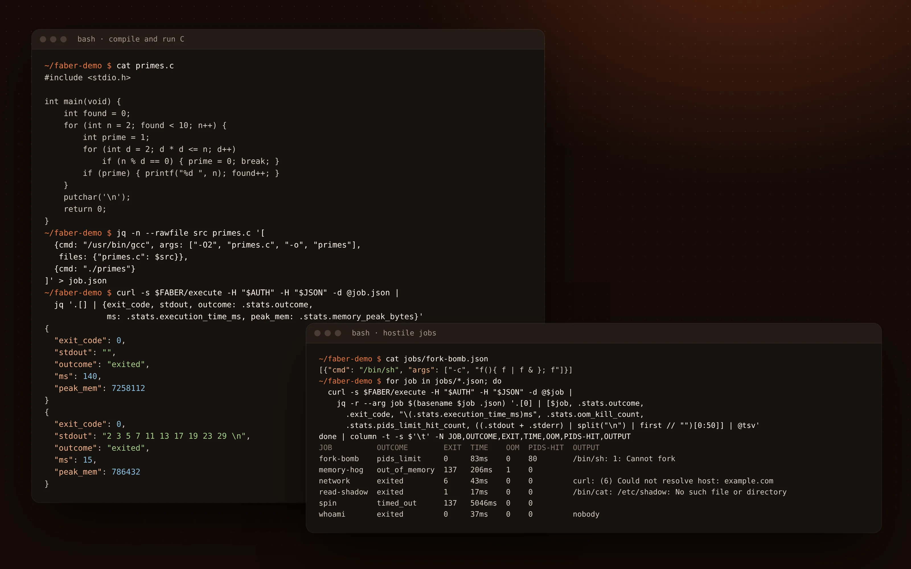
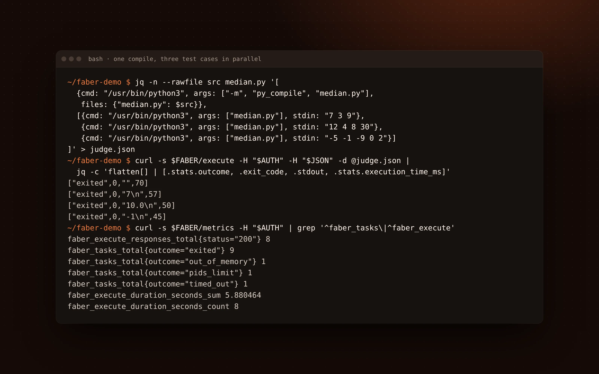
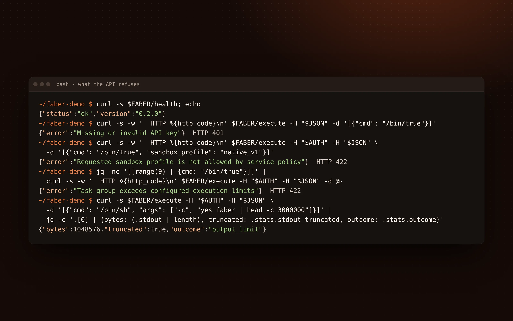
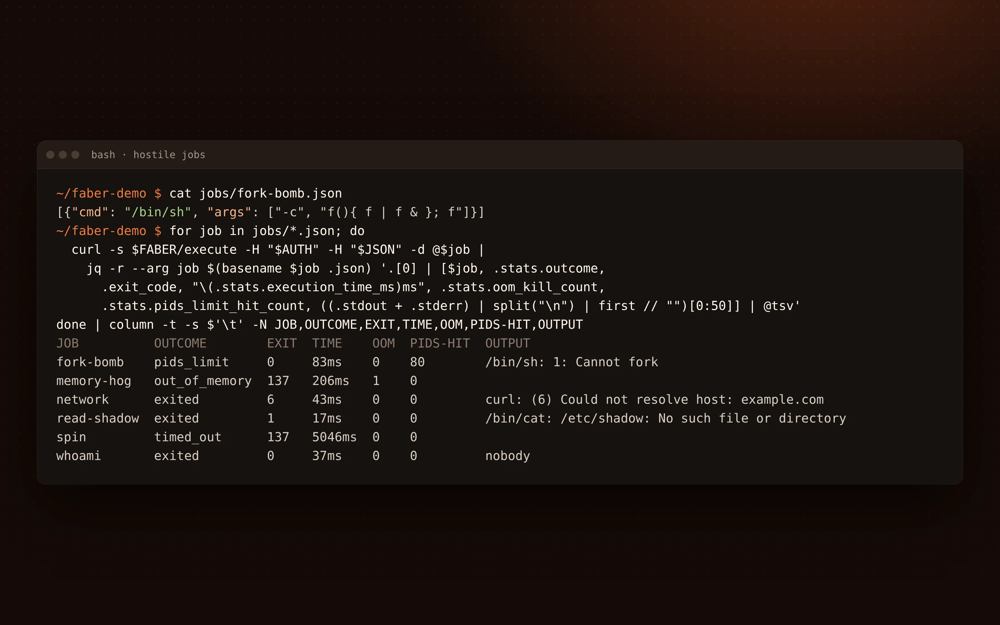

<p align="center">
  
</p>

<p align="center">
  <a href="https://github.com/Fractal-Tess/faber/actions/workflows/docker-build-push.yml"></a>
  <a href="LICENSE"></a>
</p>

<h1 align="center">Faber</h1>

<p align="center">
  
</p>

<p align="center">
  Run code you do not trust over an HTTP API, without it touching the host.
</p>

Faber is a sandbox service written in Rust. You send it a list of commands and
the files they need; it runs them in Linux namespaces under cgroup v2 limits
and a seccomp allowlist, then returns each command's output, exit code and
resource use. It is meant for code runners, online judges and build steps
where the code comes from someone else.

- **Isolate** each request in its own mount, network, IPC and UTS namespaces,
  each task in its own PID and user namespace, as an unprivileged UID with no
  network.
- **Limit** memory, processes, CPU, wall time and output per task, per request
  and for the whole service. A fork bomb ends as `pids_limit`, not as an
  outage.
- **Orchestrate** steps in order or in parallel inside one workspace, with
  Prometheus metrics and a bounded file store alongside.

This is kernel-shared isolation, the same class as a hardened container. It
does not protect against a Linux kernel vulnerability; for anonymous public
workloads, run Faber inside a VM per trust domain. See
[SECURITY.md](SECURITY.md).

## Quick start

```bash
export API_KEY=$(openssl rand -hex 32)
docker run -d --name faber --init --privileged --cgroupns=host \
  -v /sys/fs/cgroup:/sys/fs/cgroup:rw --read-only --tmpfs /tmp:size=64m \
  -e API_KEY="$API_KEY" -p 127.0.0.1:3000:3000 vgfractal/faber:latest
```

Compile a file and run the result. Steps run in order and share a workspace:

```bash
curl -X POST http://localhost:3000/api/v1/execute \
  -H "Authorization: Bearer $API_KEY" -H "Content-Type: application/json" \
  -d '[
    {"cmd": "/usr/bin/gcc", "args": ["hello.c", "-o", "hello"],
     "files": {"hello.c": "#include <stdio.h>\nint main(void) { puts(\"Hello, Faber\"); }"}},
    {"cmd": "./hello"}
  ]'
```

The image ships GCC, G++ and Make; other languages are a `FROM vgfractal/faber`
away. [INSTALL.md](INSTALL.md) covers toolchains, Compose and every setting.

## A closer look

<table>
  <tr>
    <td width="50%">
      <sub>PARALLEL STEPS</sub><br />
      <b>One compile, three test cases at once</b><br />
      
    </td>
    <td width="50%">
      <sub>GUARDRAILS</sub><br />
      <b>Requests the API turns away</b><br />
      
    </td>
  </tr>
  <tr>
    <td colspan="2">
      <sub>CONTAINMENT</sub><br />
      <b>Six hostile jobs, six recorded outcomes</b><br />
      
    </td>
  </tr>
</table>

## Documentation

- [INSTALL.md](INSTALL.md): running the image, toolchains, configuration
- [API.md](API.md): routes, task fields, outcomes and examples
- [OPERATIONS.md](OPERATIONS.md): deployment, sizing, monitoring and runbook
- [SECURITY.md](SECURITY.md): threat model and how the isolation is verified
- [CONTRIBUTING.md](CONTRIBUTING.md): development loop and the README images
- [ROADMAP.md](ROADMAP.md): what is planned and what is out of scope
- [sdks/js](sdks/js): the TypeScript client

Tested on every push: the sandbox acceptance and stress suites on x86_64 and
ARM64, and C, C++, Python, Node.js, Java, Go and Rust toolchains under the
default profile. Linux 5.8 is the minimum.

## License

MIT. See [LICENSE](LICENSE).
